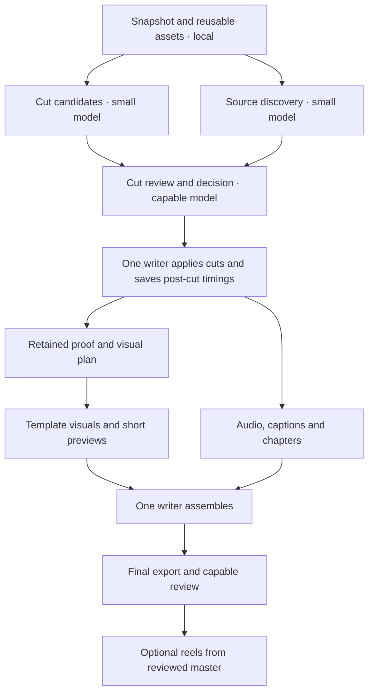

# Video Edit Pipeline

A separate staged-production skill for **Codex, Grok Build, Claude Code, and other local agent harnesses**: cut first, verify the retained claims, build timed visuals, finish and review, then derive reels. **Quality stays the acceptance gate; subscription usage and waiting are the optimization targets.**

This is a new fork of [video-edit-fast](https://github.com/Samin12/proof-first-video-editor-portable), built on the pinned writers from [proof-first-video-editor](https://github.com/Samin12/proof-first-video-editor). **Both working skills remain separate and unchanged.** Installation uses the new name `video-edit-pipeline` and its own toolchain configuration. No provider settings or original videos are replaced.

## See the pipeline

[Open the interactive pipeline](https://samin12.github.io/proof-first-video-pipeline/) · [Stage-by-stage guide](skills/video-edit-pipeline/references/pipeline.md) · [Model responsibilities](skills/video-edit-pipeline/references/model-routing.md) · [Copyable starter scenarios](skills/video-edit-pipeline/references/scenarios.md)

The interactive map also ships at `skills/video-edit-pipeline/assets/pipeline/index.html` and opens offline. Select a stage to see its model tier, tools, inputs, output and quality gate. It is a reference map, not a live dashboard or a model launcher.



## Recommended kickoff: model, effort, and team

For raw footage plus a finished style reference, start with a capable coordinator at **High effort**. In Codex, the starting recommendation is **GPT-6.1 Sol · High effort · Standard speed**. Check the first representative section against the reference before scaling the treatment to the full video.

| Harness | Coordinator | Preparation workers | Escalation |
|---|---|---|---|
| Codex | **GPT-6.1 Sol · High** for story/cut planning and acceptance reviews; **Medium** for routine execution | **GPT-6 Luna · High** for multi-tool scouting; **Low** for simple extraction | **GPT-6 Astra · Medium** initially; raise effort for the specific unresolved problem |
| Claude Code | **Sonnet 5.5 · High** for planning and acceptance reviews; **Medium** for routine execution | **Haiku 5.5 · Medium** for bounded cut/source proposals and caption findings | **Opus 5.5 · Medium** initially; raise effort for the specific unresolved problem |
| Grok Build | **Grok 4.7 · High** for lead decisions/review; **Medium** for bounded execution | An available suitable model at **Medium**; **Low** only for simple checks | **High**, then **xhigh** for a specific unresolved hard task; no `max` setting |

High effort helps reconcile the story, reference style, factual risks, and task dependencies. Once that plan exists, dispatching workers and applying reviewed instructions are routine. If the host cannot switch coordinator effort cleanly, leave it High; the user does not need to babysit phase changes. Set each worker's model **and** effort explicitly, verify the resolved settings, and record any fallback. A small model may need high effort for reliable multi-tool work. Effort scales and subscription usage differ across providers.

Use **one coordinator and at most two active preparation workers** initially. Reuse the worker slots between stages. The coordinator can also own the timeline; one writer means one responsibility, not an extra permanent agent.

| Responsibility | Assignment and boundary |
|---|---|
| Propose retake cuts, repetitions, source leads, or caption defects | Small worker; one scene/claim packet; returns candidates and uncertainty; does not make final deletions |
| Decide narrative cuts and accept factual proof | Capable coordinator at High effort; inspect context and actual evidence |
| Fill an approved visual template | Bounded worker; capable reviewer accepts the preview; new layout/animation code goes to a capable model |
| Apply cuts or place visuals | One timeline owner using the checked Borumi scripts, live state and readback |
| Timing, hashes, subtitle mapping, rendering and technical checks | Local scripts; no separate model needed for the computation |
| Final editorial/audio/visual review | Capable model at High effort with actual playback tools; escalate unresolved hard decisions |

These recommendations were checked **2026-10-16** and are starting points, not a cross-model quality benchmark. Model labels in the skill do not configure the harness automatically. [Official sources, effort details and runtime configuration](skills/video-edit-pipeline/references/model-routing.md).

## Install and use

[Download the skill ZIP](https://github.com/Samin12/proof-first-video-pipeline/releases/latest/download/video-edit-pipeline.zip) and extract its `video-edit-pipeline` folder into `~/.agents/skills/`, or use the clone-based installer below. The downloaded folder includes the same setup script; run its `scripts/setup.py fetch` once before Borumi editing.

```bash
git clone https://github.com/Samin12/proof-first-video-pipeline.git
cd proof-first-video-pipeline
python3 skills/video-edit-pipeline/scripts/setup.py install
python3 skills/video-edit-pipeline/scripts/setup.py fetch
python3 skills/video-edit-pipeline/scripts/run.py doctor
```

The skill is linked into `~/.agents/skills/video-edit-pipeline`, a shared location supported by Codex and Grok Build. Keep the checkout and refresh/restart skill discovery. The fetch step gets pinned public dependencies into an isolated directory; it preserves existing installations and video projects.

For **Claude Code**, run `setup.py install --harness claude`, then use `/video-edit-pipeline`. Other local harnesses can read [SKILL.md](skills/video-edit-pipeline/SKILL.md) and use the same scripts. A browser chat without access to the Mac can prepare research/plans but cannot directly edit local Borumi. [Harness setup and compatibility](skills/video-edit-pipeline/references/harnesses.md).

## Raw-to-finished starter prompt

Select the coordinator model/effort above. In Codex, paste the following and substitute your actual project names. In Claude Code or Grok Build, change the first line to **`/video-edit-pipeline`**. Use the same outcome and quality checks across harnesses.

```text
$video-edit-pipeline

Use “Tutorial raw” as the Borumi source and the current finished “Tutorial”
as the style and quality reference. Locate and verify both. Create a separate
working copy; preserve the originals and existing working skills.

Start with a representative 30–60-second section in a scene-scoped pilot job.
Match the reference's pacing, real proof visuals, camera layout, captions and
audio quality. After that treatment passes review, continue the full video
from a fresh working-copy snapshot and reuse the accepted pilot assets.

Use High coordinator effort for planning, cut decisions and final review;
Medium for routine execution when supported. Use at most two preparation
workers with the skill's model-specific effort settings. Verify each worker's
actual model and effort, and report unsupported settings or fallbacks.

Prepare cut candidates and source leads in parallel. Review and apply cuts,
then refresh timings before producing visuals for the retained claims.
Keep one timeline writer. Reuse research, real screenshots/tweets, templates
and timed transcripts. Use local code for timing, captions and rendering.

Save checkpoints. Deliver the reviewed master, corrected captions, chapters,
source ledger and review evidence. Use existing authorized tools/capacity;
do not add paid API or generation jobs without an agreed budget.
Flag unsupported claims. Do not upload or publish the video.
```

The runner scopes by scene, so the coordinator must select a real scene ID for the pilot; an unscoped job prepares the whole video. [Exact pilot commands, preparation-only mode, reels, and cross-harness resume prompts](skills/video-edit-pipeline/references/scenarios.md).

## How this saves time and usage

| Work | Default route |
|---|---|
| Inventory, timing, hashes, subtitles, render preparation | Local deterministic scripts |
| Simple extraction and candidate selection | One scene packet; smaller model only after quality checks |
| Story, ambiguous edits, final judgment | Balanced/strong model only where needed |
| Research | Existing source cache first; targeted search/capture for missing claims |
| Visuals | Reusable local templates; real source captures |
| Generated shots | Optional Higgsfield or another verified provider within a set budget |
| Parallelism | Two independent workers initially; one Borumi writer |
| Continuation | Saved goal, scene state, artifacts and hash-checked receipts |

Choose **fast** for targeted cuts, **proof** for full evidence-led production, and **reel** for vertical derivatives. Existing timed transcripts are reused. Completed sources and renders are reused when their inputs remain valid. A small edit does not trigger an entire audio/research/visual pipeline.

Parallelism reduces waiting only where tasks are independent; it does not create more subscription allowance. The priority is to reduce consumed plan capacity per accepted edit, not to choose the cheapest model at any cost. Optional extra paid jobs default to **$0** until a budget is supplied; that setting is a billing guard, not the quality target. Model speed modes and API authentication can change which allowance or bill is used.

Start with the [pipeline](skills/video-edit-pipeline/references/pipeline.md) and [raw-to-finished prompt](skills/video-edit-pipeline/references/scenarios.md). Read the [quota workflow](skills/video-edit-pipeline/references/quota-workflow.md) and [service research](research/services-and-costs.md) as needed. Example API arithmetic is not a promise about subscription usage or video quality.

## What's included

- [The skill](skills/video-edit-pipeline/SKILL.md), with references loaded only for the active stage.
- `run.py`: staged dependency graph, model-role metadata, mode/scoped packets, resumable receipts, content cache, and explicit cost arithmetic.
- `setup.py`: install, isolated pinned toolchain, and correctly configured calls to existing Borumi scripts.
- `reel.py`: frame-mapped rough reels and optional SRT remapping from a reviewed local master.
- [Styled reel template](skills/video-edit-pipeline/assets/reel-template/): reusable local composition for camera/proof cards, captions, progress, and CTA.
- [Borumi study](research/borumi-patterns.md) and [validation record](research/validation.md).

The job runner is a state helper, **not an autonomous model scheduler or a hard spending limiter**. Your harness carries out its ready tasks. Structural checks are not visual QA; the final export must be watched and heard. [Job protocol](skills/video-edit-pipeline/references/jobs.md), [QA](skills/video-edit-pipeline/references/qa.md).

## Requirements and boundaries

Python 3.9+ for helpers; FFmpeg/ffprobe for media; macOS with Borumi and MCP enabled for timeline edits. The inherited writers need their documented image/audio dependencies. Styled motion uses Remotion and the existing animation kit; install that only when needed. Service connections and authentication are configured separately in each harness.

The isolated legacy bridge is patched to decline automatic consent prompts and uses port 47813. Timeline changes still go through a backup, staged transaction, live hash check, frame inspection, and committed readback. No private footage, transcripts, screenshots, account data, or credentials are included in this repository. The skill does not publish your videos automatically.

## Test

```bash
python3 -m unittest discover -s tests -v
python3 skills/video-edit-pipeline/scripts/run.py --help
```

Exact measured validation and remaining limits are in [validation.md](research/validation.md). Lower-cost model quality equivalence has not been established by a controlled full-video benchmark.

MIT. Builds on Samin Yasar's [proof-first-video-editor](https://github.com/Samin12/proof-first-video-editor), [edit-borumi-video](https://github.com/Samin12/edit-borumi-video), and [opencutagent-borumi](https://github.com/Samin12/opencutagent-borumi).
