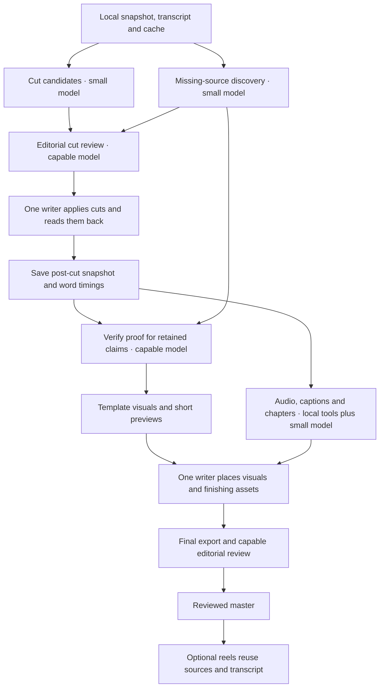

# Production pipeline and worker ownership

Use this map for a new full edit or when assigning workers. Use [model routing](model-routing.md) for current model examples and the [job protocol](jobs.md) for executable helper commands. Open [the interactive map](../assets/pipeline/index.html) locally to inspect each stage. The map explains orchestration; it does not launch agents or represent a live editing session.

## Why cuts precede timed visuals

First decide which narration survives. Creating motion graphics, mastering the entire mix, or timing captions against a cut that is still changing causes avoidable rework. Discovery may run early; full capture, generation and rendering should concentrate on retained claims. Investigate a claim early when its truth could change the story or require a correction. Never postpone that contradiction merely to keep cutting.

“Cut lock” is a coordinator quality gate, not an extra user approval request. It means the selected takes, protected meaning, timing and relevant claim issues have been reviewed. Proceed under the user's existing edit authorization. A later editorial change is allowed; reopen that milestone and rebuild its dependent timing, captions, visuals and exports.

## Assign work by stage

| Stage | Owner and tools | Return before advancing |
|---|---|---|
| Inventory | Coordinator runs snapshot, transcript export, file/hash checks and ffprobe locally. No extraction agent needed. | Exact project, source backup, baseline hash, scene index and missing inputs. |
| Cut candidates | Small-model worker reads one scene packet and nearby context. Mark retakes, dead air and possible removals. | Candidate ranges with reasons, preserved meaning and uncertain cases. No timeline writes. |
| Missing sources | A second small-model worker checks the cache, then targeted search/browser or optional Firecrawl. | Canonical URLs, exact supported passages, capture candidates and contradictions. Search snippets alone are not verified proof. |
| Editorial cut review | Capable coordinator reads candidate ranges, original context and any story-changing evidence. Uses targeted playback. | Accepted cut plan, protected moments and resolved blockers. Escalate difficult narrative judgment; do not rewrite meaning to fit a weak source. |
| Cut application | One timeline owner runs the inherited transaction scripts, dry run, diff, frame checks and committed readback. | Commit evidence, resulting timeline hash, post-cut snapshot and timed words. |
| Retained proof | Capable verifier checks claim-to-source support and actual capture pixels for claims left in the cut. Small worker may collect the requested captures. | Verified assets and source ledger, with unsupported claims explicitly blocked. |
| Finishing preparation | Local audio checks, subtitle/chapters mapping and render preparation. Small model proposes name/number corrections. | Audio observations and mapped captions/chapters for the post-cut timeline; ambiguous corrections go to the coordinator. |
| Visuals | Small worker fills an accepted template. Capable worker handles a new layout, complex animation or unfamiliar code. Remotion/FFmpeg renders locally. | Correct asset/time map, representative still and short preview. Full resolution follows acceptance. Generated shots require an approved brief and available authorized spending. |
| Placement and final | Same timeline owner applies assets. Capable reviewer watches/hears the exported result against the brief. | Readback, coverage and media checks, reviewed export and unresolved issues. A premium reviewer is reserved for demanding material or a failed capable review. |
| Reels | Small worker proposes self-contained moments from the reviewed master; capable coordinator chooses. Local tools map time and render. | Phone-size review of hook, context, captions, evidence and ending. No new proof research unless the reel adds or changes a claim. |

## Parallelism that helps

Use one coordinator and at most two **active preparation workers** initially. Candidate cuts and missing-source discovery can overlap. After cut lock, retained-proof preparation and audio/caption preparation can overlap. Template rendering and independent caption checks may overlap within available CPU/GPU capacity. These are roles, not a permanent ten-agent team: reuse or stop a worker when its assignment finishes.

Do not run two timeline writers, two coordinators dispatching the same manifest, or multiple full-video critics by default. While one writer holds the project, others prepare files only. Split distinct scenes/topics; never give every worker the full transcript and every source. Parallelism can shorten waits but does not reduce total usage by itself.

Each dispatch includes: task ID, objective, input packet and dependency artifacts, actual runtime model, permitted tools, output path/schema, acceptance checks, and escalation condition. Record the model the harness actually used; a role label does not select a model. Allow one focused correction attempt, then escalate or change method. Missing evidence stays unresolved.

## Smaller requests

- **Quick edit:** candidates → editorial review → one checked write → relevant finishing/export review. Skip proof discovery and new visuals when the request does not need them.
- **Preparation only:** stop at the reviewed plan/handoff. No cut application, placement, paid generation or final render. A prepared milestone is not a finished edit.
- **Reel only:** reviewed source master → candidates → selection → reframing/caption mapping → render → review. No Borumi writer is needed for a local derivative.
- **Resume:** verify checkpoints and live state; resume the first affected stage. Do not repeat accepted research simply because the harness changed.

The manifest enforces dependencies between recorded tasks. The harness still dispatches workers and performs the operations. Receipts establish file integrity and asserted stage completion; they do not establish that a model actually watched, heard or understood a video.
